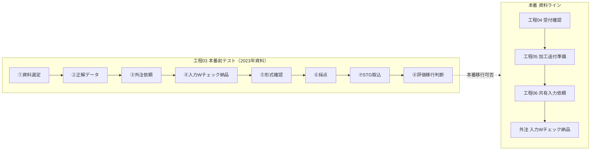

# 擦り合わせ資料：工程03〜06（外注テスト・資料受付〜入力依頼）

**用途**：担当割当・引き渡し・完了条件を会議で確認するためのたたき台。  
**対象期間**：本番前テスト（工程03）と本番資料ライン（工程04→05→06）。  
**更新**：記載内容は提供仕様の整理であり、未決・要割当はそのまま議論項目とする。

---

## 1. この資料の使い方（会議アジェンダ例・30〜45分）

| 順 | 議題 | 確認すること |
|----|------|----------------|
| 1 | 全体像（§2） | 03と04〜06の関係、本番移行判断の位置 |
| 2 | 担当マップ（§3） | 「未定」の割当案・ダブりの有無 |
| 3 | 引き渡し（§4） | 渡す物・受け取り側の確認観点 |
| 4 | 工程別作業（§5〜8） | 手順の認識ズレ・省略の有無 |
| 5 | 未決・要確認（§9） | 決定期限・決定者 |
| 6 | 擦り合わせチェック（§10） | 合意欄の記入 |

---

## 2. 全体像（2本のライン）

- **工程03**：精度・時間・イチニ確認工数を測り、届出順不一致・文字化け・氏名ヨミ誤入力が再発しないかを見る。正解データは**外注に渡さない**。
- **工程04〜06**：選管資料を漏れ・重複・誤送付なく外注へ渡す。訂正は作業段階に応じて差し替え or DB修正 or 再納品。

---

## 3. 担当マップ（擦り合わせ用）

### 3.1 キーパーソン（確定・記載あり）

| 役割 | 氏名／部署 | 関与工程 | 会議で確認すること |
|------|------------|----------|-------------------|
| 体制・移行判断 | 内山マネージャー | 03・04・05・06 | 人員不足時の例外、本番移行の最終判断 |
| 外注方針・調整 | 加藤 | 03・04・05・06 | 依頼窓口、訂正連絡、再納品条件 |
| STG技術対応 | システム部 | 03⑦ | 不具合時の連絡経路・SLA |
| 選管問い合わせ | 電話チーム | 04⑦ | 電話指示管理の登録フォーマット |

### 3.2 要割当（議論欄）

| ブロック | 工程 | 主な作業 | 割当案（記入） | 人数 |
|----------|------|----------|----------------|------|
| テスト準備 | 03 | テスト資料・正解データ、検品・STG取込 | | |
| テスト入力側記録 | 03 | 外注は入力；イチニは⑤⑥ | | |
| 資料受付・確認 | 04 | SS・メール・HP・PDF内容・引継ぎ | | |
| 資料加工 | 05 | 印刷・赤入れ・スキャン | | |
| PDF検品・Drive | 05 | ⑤⑥、フォルダ権限 | | |
| 外注出荷管理 | 06 | 管理表・共有・受領確認 | | |
| 納品後DB修正 | 04⑨・06 | 軽微修正・訂正後対応 | | |

---

## 4. 引き渡しマトリクス（渡す物・完了条件）

| # |  From | To | 渡す／共有するもの | 受け側が見る完了条件 | 戻し・例外 |
|---|-------|-----|-------------------|----------------------|------------|
| H1 | 工程02 | 03③・06 | 入力仕様書・CSV形式・サンプル | 最新版であること | 仕様変更は加藤経由で再共有 |
| H2 | 03① | 03② | 選定した2023 PDF一覧 | 6選挙・50〜100名規模、ミス再現ケース含む | |
| H3 | 03② | 03⑥ | 正解データ（SS） | 原本照合済み、「確認対象」区分 | **外注非共有** |
| H4 | 03③ | 外注 | 資料・仕様・CSV・マスタ・例、期限 | 受領・着手可否の回答 | 判読不能は「*」、停止問題はチャット |
| H5 | 外注 | 03⑤ | CSV・作業実績シート | 形式・件数・実績記入 | |
| H6 | 03⑥ | 03⑧ | チェック結果シート | ミス件数・要確認の区別 | **納品CSVを直接修正しない** |
| H7 | 03⑥修正後 | 03⑦ | STG用CSV（テストID） | ミス修正済・空欄変換ルール | 本番不可 |
| H8 | 04①〜④ | 04⑤ | 保存済みPDF・取得メタ | 重複なし・最新版 | 手動／自動の切替 |
| H9 | 04⑤⑥⑦ | 04⑧ | 確認結果・加工要否 | 候補者数・届出順・不備記録 | 電話待ちは明示 |
| H10 | 04⑧ | 05① | PDF・加工指示・電話回答 | 対象選挙・最新版・赤入れ指示 | NHK不足は別途共有 |
| H11 | 05⑤ | 05⑥ | 検品済みPDF（Drive） | ページ・赤入れ・×印OK | 再スキャンループ |
| H12 | 05⑦ | 06 | 外注用フォルダ・件数・注意 | 未確認PDFが混ざっていない | リネーム方針の共有 |
| H13 | 06 | 外注 | Drive共有・依頼文（Chatwork等） | 受領確認を管理表へ | 訂正版は段階別（04⑨） |

---

## 5. 工程03：具体的作業カード

| Step | 作業名 | 誰 | 具体的にやること | 成果物 | 完了の定義 |
|------|--------|-----|------------------|--------|------------|
| ① | テスト資料選定 | テスト準備担当 | 2023告示・投開票から通常＋文字潰れ・通称差異を選ぶ | 資料リスト | 目安規模に達している |
| ② | 正解データ | テスト準備担当 | 登録済みデータをコピーし原本照合、SS化 | 正解SS（社内） | 外注に未流出 |
| ③ | 外注依頼 | 加藤＋準備 | 資料パック共有、開始・期限明記、Wチェック報告依頼 | 依頼記録 | 外注受領 |
| ④ | 入力〜納品 | **外注** | 入力・マスタ照合・Wチェック・納品・実績 | CSV・実績SS | 期限内納品 |
| ⑤ | 形式確認 | イチニ | 選挙区・候補者数・CSV形式・実績記入 | 確認メモ | ⑥へ |
| ⑥ | 採点 | イチニ | 正解・原本と照合、結果シートに記録 | チェック結果SS | 件数・時刻記録 |
| ⑦ | STG | 検品担当＋システム部 | ID置換・アップロード・名寄せ・得票 | STG結果記録 | 本番未使用 |
| ⑧ | 評価 | 内山MG＋加藤 | 集計、振り返り、再テスト・移行判断 | 評価メモ | 管理側合意 |

### Wチェック（未決・擦り合わせ必須）

| 方式 | 内容 | 比較観点 |
|------|------|----------|
| A（第一希望） | 2名が同原本を独立入力→突合 | 精度・時間・費用 |
| B | 別担当が原本と目視照合 | 同上 |
| 方針 | 佐藤司：品質・速度・費用で総合判断 | **正式方式は未決定** |

---

## 6. 工程04：具体的作業カード

| Step | 作業名 | 誰 | 具体的にやること | 成果物 | 完了の定義 |
|------|--------|-----|------------------|--------|------------|
| ① | 自動取得確認 | DBチーム | 自動出力SSで選挙区・保存先・重複除外 | 対象一覧 | 入力対象のみ |
| ② | 対象外メール | DBチーム | info等の訂正版、最新版の保存先 | 追記一覧 | 古版を外注送付しない |
| ③ | HP巡回 | DBチーム | 告示・投開票更新、監視ツール優先 | 巡回記録 | |
| ④ | HP取得保存 | DBチーム | DL/キャプチャ、URL・日時 | ファイル | 自動取得と重複なし |
| ⑤ | PDF内容 | DBチーム | 定数・候補者数・文字潰れ・不足シート | 確認シート | |
| ⑥ | 構成確認 | DBチーム | 不要ページ・分割要否を05へ | 加工指示 | PDF加工は05で実施 |
| ⑦ | 不備依頼 | DBチーム→電話 | 電話指示管理登録、内山MG判断 | 回答待ち管理 | |
| ⑧ | 引継ぎ | DBチーム | 05へPDF・加工、NHKへ不足 | 引継ぎメモ | |
| ⑨ | 訂正対応 | 加藤・DB | 外注作業段階に応じ差し替え/DB修正/再納品 | 対応ログ | 方針は運用開始前に確定 |

**DBチーム作業の3分割（仕様上の整理）**

1. 取得：SS・info・HP・DL/キャプチャ  
2. 内容確認：候補者数・届出順・不備・電話登録・NHK共有  
3. 引継ぎ：電話回答・最新版・05への加工指示  

※ infoメール確認の目的について内山氏コメント（2026.11.2）あり → **会議で目的を明文化**

---

## 7. 工程05：具体的作業カード

| Step | 作業名 | 誰 | 具体的にやること | 成果物 | 完了の定義 |
|------|--------|-----|------------------|--------|------------|
| ① | 指示確認 | 加工担当 | 04引継ぎとPDF一致、未確認の切り分け | 作業可判定 | 不明は04へ戻す |
| ② | 印刷除外 | 加工担当 | 必要頁印刷、送付状等除外（原本PDF不編集） | 紙束 | |
| ③ | 赤入れ | 加工担当 | 選挙名・人数・届出順・×印・電話回答赤字 | 加工済み紙 | 推測で埋めない |
| ④ | スキャン | スキャン担当 | 選挙区ごと1PDF、Drive自動保存 | 生PDF | この段階リネームしない |
| ⑤ | PDF検品 | 検品担当 | ページ・赤入れ・混在なし（Aと別人推奨） | 検品OK | 不備は再スキャン |
| ⑥ | 外注フォルダ | Drive担当 | 確認済みのみ格納、権限確認 | 共有フォルダ | 未確認を含めない |
| ⑦ | 06引継ぎ | 検品/Drive | 保存先・種別・候補者数・注意・リネーム方針 | 引継ぎ | 送付依頼は06 |

**05で決めたいこと（擦り合わせ）**

- 印刷・赤入れ・スキャン・検品の人数とタイミー活用  
- PDFファイル名：DBリネーム vs 外注リネーム（費用・納期）  
- 訂正版の差し替え連絡（加藤と整合）

---

## 8. 工程06：具体的作業カード

| Step | 作業名 | 誰 | 具体的にやること | 成果物 | 完了の定義 |
|------|--------|-----|------------------|--------|------------|
| 準備 | 管理表 | 出荷管理 | 出荷・版・日時・納期・進捗（二重入力回避） | 外注管理表 | |
| 確認 | 出荷対象 | 出荷確認 | 検品済PDF・仕様・CSV準備 | OKリスト | |
| 共有 | Drive | 共有担当 | 権限、旧版・加工中を混在させない | 共有URL | |
| 依頼 | 入力依頼 | **加藤** | 対象・件数・納期・受領確認（Chatwork第一希望） | 依頼文 | 受領確認済 |
| 実施 | 外注作業 | **外注** | 入力・Wチェック・CSV納品 | CSV | 管理表更新 |

**06で決めたいこと**

- 作業シート分割単位（全共通 / 選挙まとめ / 1選挙）  
- 夜間問い合わせ体制  
- 補足資料の優先参照ルール（重複入力防止）

---

## 9. 未決・要確認一覧（決定記入欄）

| ID | 内容 | 関連 | 決定者 | 期限 | 決定内容（記入） |
|----|------|------|--------|------|------------------|
| U1 | Wチェック正式方式 | 03 | | | |
| U2 | 工程03各担当の割当 | 03 | 内山MG | | |
| U3 | 工程04〜06 DB・加工・出荷の割当 | 04-06 | 内山MG | | |
| U4 | infoメール確認の運用目的 | 04 | | | |
| U5 | 自動 vs 手動取得（専用ラベル） | 04 | | | |
| U6 | HP監視の通知先 | 04 | | | |
| U7 | PDFリネーム担当 | 05・06 | | | |
| U8 | 外注へのリネーム費用・納期 | 05・06 | 加藤 | | |
| U9 | 作業SS分割方針 | 06 | | | |
| U10 | 訂正後の再納品条件・期限 | 04⑨・06 | 加藤 | | |
| U11 | 納品後軽微修正のDB担当 | 04⑨ | | | |

---

## 10. 擦り合わせチェックリスト（合意）

会議後、担当者が記入する。

- [ ] 全体像（03と04〜06）の理解が一致した  
- [ ] §3.2 の要割当に名前（または暫定）が入った  
- [ ] 引き渡し H1〜H13 の「誰が受け取るか」が明確  
- [ ] 工程03テストの開始日・納期の置き方が合意  
- [ ] 訂正資料の三段階（作業前/中/納品後）の対応が合意  
- [ ] §9 の優先度高項目に期限が付いた  
- [ ] 次回：　　　　　　までに　　　　　　を確定する  

**記録**

| 日付 | 参加者 | 決定事項サマリ |
|------|--------|----------------|
| | | |

---

## 付録：関連リンク（工程04仕様記載）

- [自動出力スプレッドシート](https://docs.google.com/spreadsheets/d/1DjPvPa0T9iVOG7zflo9IcF9FjuAD1pFSbs0q6_ofbM8/edit?gid=721277751#gid=721277751)
- [手動式スプレッドシート](https://docs.google.com/spreadsheets/d/1JA9YS7wcg3d63JYa3M8dZp953WD3bpIo1Klu0rfZzn4/edit?gid=0#gid=0)
- [自治体HP更新監視ツール](https://docs.google.com/spreadsheets/d/1OvnTZNRcNSVSWNjUYY4fbWNoc4TyQRFLTG-MxhHZPW4/edit?gid=2072469722#gid=2072469722)
- [運用ルール](https://docs.google.com/spreadsheets/d/1Tt02j6IXBqzW6E55hwjxdb_WQPBasLHsITLrs1g6oiU/edit?gid=0#gid=0)
- [PDFデータ化の方法（工程05）](https://docs.google.com/spreadsheets/d/1xg551yH-4raJ39TzK-DvTw2jcM7eeLObQv7wV3Zp0xY/edit?gid=1768312257#gid=1768312257&range=A1)